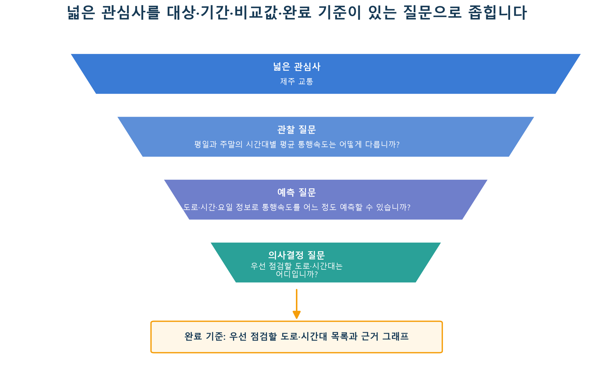
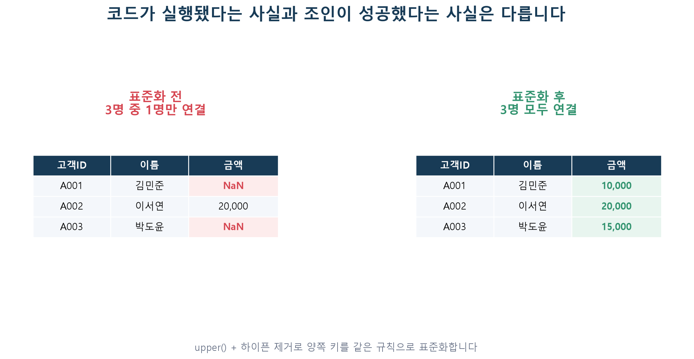
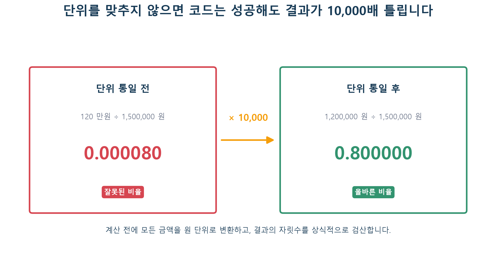
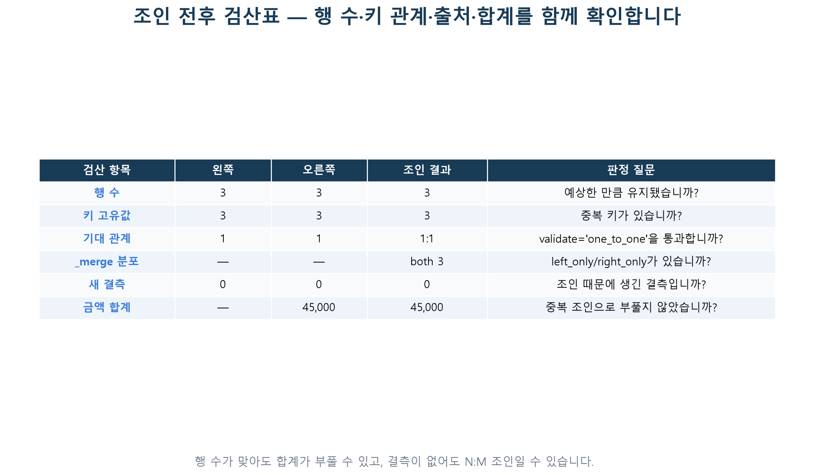

# 8주차 — 자유 프로젝트 / 제공 트랙

## 이번 주 목표

7주 동안 배운 내용을 하나로 연결해, **스스로 질문 하나를 정하고 작은 분석 또는 실행 시도를 공유합니다.** 프로젝트 완성과 좋은 성능보다 어디까지 시도했고 무엇을 다음 행동으로 정했는지가 중요합니다.

아래 목표는 프로젝트를 더 발전시킬 때 참고하는 방향입니다. 기본 범위에서는 질문·시도·관찰·다음 행동을 한 줄씩 남기면 충분합니다.

- 관심사를 분석 가능한 질문으로 좁힙니다.
- 질문에 맞는 분석 단위, 비교 기준, 평가 방법을 먼저 정합니다.
- 외부데이터를 결합할 때 키·단위·행 수가 의도대로 유지되는지 검증합니다.
- 필요한 분석만 선택하고, 결과를 뒷받침하는 핵심 근거를 남깁니다.
- 결론과 함께 데이터·방법의 한계와 다음 행동을 제시합니다.

## 데이터 다운로드

아래 링크는 `README.md`에 안내된 8주차 제공 트랙의 원본 페이지입니다. ✅ 기본 학습에서는 링크 하나와 노트북의 예상 경로만 확인하면 되며, 파일을 내려받을 필요는 없습니다. 실제 데이터를 불러오는 도전·확장 학습을 선택했다면 해당 페이지에서 데이터 설명과 이용 조건을 먼저 살펴본 뒤 파일을 내려받습니다.

- [제주도교통량](https://dacon.io/competitions/official/235985)
- [신용카드세그먼트](https://dacon.io/competitions/official/236460)

원본을 내려받은 날짜와 사용한 파일명을 함께 기록해 두면, 나중에 분석 과정을 다시 실행하거나 다른 사람과 결과를 비교할 때 도움이 됩니다.

## Part 1 — 질문을 좁히는 참고 체크리스트

데이터를 열기 전에 참고할 네 가지 질문입니다. 기본 시도에서는 첫 번째 질문 한 문장만 정해도 됩니다. 나머지는 프로젝트를 더 진행하고 싶을 때 하나씩 덧붙입니다.

1. **무엇이 궁금합니까?** — 한 문장 질문으로 적습니다.
2. **그 질문에 답하려면 어떤 데이터가 필요합니까?** — 필요한 데이터를 실제로 확보할 수 있습니까?
3. **완료를 어떻게 판단합니까?** — 숫자/목록/지도 중 무엇으로 결론을 냅니까?
4. **발표에서 무엇을 보여줍니까?** — 그래프 1~2개로 결론이 바로 전달됩니까?

이 네 가지를 먼저 정리해 두면 코드를 작성하는 동안에도 분석의 방향을 편안하게 확인할 수 있습니다.

### 넓은 주제를 분석 가능한 질문으로 바꾸기

“제주 교통량을 분석합니다”는 주제이지 질문은 아닙니다. 질문에는 대상, 비교 또는 예측할 값, 범위가 들어가야 합니다.

| 단계 | 예시 |
|---|---|
| 넓은 관심사 | 제주 교통 |
| 관찰 가능한 질문 | 평일과 주말의 시간대별 평균 통행속도는 어떻게 다릅니까? |
| 예측 질문 | 도로·시간·요일 정보로 통행속도를 어느 정도 예측할 수 있습니까? |
| 의사결정 질문 | 혼잡이 반복되는 도로와 시간대 중 우선 점검할 곳은 어디입니까? |

한 프로젝트에서는 핵심 질문 하나와 이를 보조하는 하위 질문 1~2개에 집중하면 결론을 더 선명하게 전달할 수 있습니다.



*캡션: ‘제주 교통’처럼 넓은 관심사를 관찰·예측·의사결정 질문으로 구체화하는 과정입니다.*

> **노트북 연결:** `example.ipynb` Part 1의 체크리스트로 이동하여 내 질문에 대상·기간·비교값·완료 기준이 들어 있는지 함께 확인해 봅니다.

### 분석 단위를 한 문장으로 적기

분석 단위는 표의 **한 행이 무엇을 뜻하는가**입니다. 도로 관측 1건, 고객 1명, 고객의 월별 상태 1건은 서로 다른 단위입니다. 분석 단위가 불분명하면 같은 고객을 여러 명처럼 세거나, 시간별 관측을 독립된 사람처럼 취급하는 오류가 생깁니다.

예: “이 분석에서 한 행은 특정 도로 구간에서 특정 날짜·시간대에 측정한 통행 기록 1건입니다.”

### 완료 기준을 미리 정하기

완료 기준은 “그래프를 많이 만듭니다”가 아니라 질문에 답했다고 판단할 증거입니다.

- EDA: 비교 집단의 차이와 변동을 보여주는 요약표·그래프
- 회귀: 기준 모델 대비 RMSE 개선과 잔차 점검
- 분류: 다수 클래스 기준선 대비 적절한 지표 개선과 클래스별 오류
- 군집: K 선택 근거, 군집별 특징, 군집의 안정성과 활용 방안
- 공간분석: 거리·반경의 정의, 현재와 개선안의 커버리지 비교

모델링은 선택 사항입니다. 질문이 “어떤 집단에서 차이가 나타납니까?”라면 잘 설계된 EDA가 불필요한 예측 모델보다 더 직접적인 답이 될 수 있습니다.

## Part 2~3 — 외부데이터를 결합할 때 살펴볼 부분

### ① 키 매칭
서로 다른 곳에서 온 두 테이블을 합칠 때, ID 형식이 `A001`과 `a001`, `A-003`처럼 미묘하게 다르면 오류 메시지는 없지만 일부 행만 연결되고 나머지 값은 `NaN`으로 채워질 수 있습니다. `customers`(3명)와 `orders`(3명)를 그대로 조인하면 대소문자와 하이픈이 달라 1명만 연결됩니다. 양쪽 키를 `upper()` + 하이픈 제거로 문자열 표준화한 뒤 다시 조인하면 3명 모두 연결됩니다. 이처럼 조인 뒤에 `NaN` 개수와 연결된 행 수를 확인하면 표기 차이를 일찍 발견할 수 있습니다.

`example.ipynb` Part 2의 핵심 코드는 다음과 같습니다. 실행 전에 어느 고객의 금액이 `NaN`이 될지 먼저 예상해 봅니다.

```python
import pandas as pd

customers = pd.DataFrame({
    "고객ID": ["A001", "A002", "A003"],
    "이름": ["김민준", "이서연", "박도윤"],
})
orders = pd.DataFrame({
    "고객ID": ["a001", "A002", "A-003"],
    "금액": [10000, 20000, 15000],
})

merged = customers.merge(orders, on="고객ID", how="left")
merged
```

```text
   고객ID   이름       금액
0  A001  김민준      NaN
1  A002  이서연  20000.0
2  A003  박도윤      NaN
```

코드는 오류 없이 끝났지만 3명 중 1명만 연결되었습니다. 다음 셀에서 키를 표준화하고 다시 조인합니다.

```python
def normalize_id(s):
    return s.str.upper().str.replace("-", "", regex=False)

customers["고객ID_정규화"] = normalize_id(customers["고객ID"])
orders["고객ID_정규화"] = normalize_id(orders["고객ID"])

merged_fixed = customers.merge(orders, on="고객ID_정규화", how="left")
merged_fixed[["고객ID_x", "이름", "금액"]]
```

```text
  고객ID_x   이름     금액
0    A001  김민준  10000
1    A002  이서연  20000
2    A003  박도윤  15000
```



*캡션: `example.ipynb` Part 2의 출력을 바탕으로, 표준화 전 `NaN` 두 칸이 대소문자·하이픈 제거 후 올바른 금액으로 채워지는 과정을 표시했습니다.*

> **그림 읽기:** 코드가 오류 없이 실행된 것과 의도한 키가 모두 연결된 것은 어떤 점에서 다른지 함께 살펴봅니다.

### ② 단위 통일
키가 맞아도 단위가 다르면 의도와 다른 계산 결과가 나올 수 있습니다. 매출이 '원' 단위, 예산이 '만원' 단위인 두 테이블을 그대로 나누면 실제보다 10,000배 작은 비율이 나옵니다. 먼저 단위를 같은 기준으로 맞춘 뒤 계산하면 이 차이를 예방할 수 있습니다. 코드가 오류 없이 실행되더라도 결과 숫자가 데이터의 단위와 가능한 범위에 맞는지 검산해 두는 습관이 도움이 됩니다.

`example.ipynb` Part 3에서는 같은 식을 단위 통일 전후로 계산합니다.

```python
sales = pd.DataFrame({"상품": ["A", "B"], "매출_원": [1_500_000, 2_300_000]})
budget = pd.DataFrame({"상품": ["A", "B"], "예산_만원": [120, 200]})

m = sales.merge(budget, on="상품")
m["잘못된_비율"] = m["예산_만원"] / m["매출_원"]
m["예산_원"] = m["예산_만원"] * 10_000
m["올바른_비율"] = m["예산_원"] / m["매출_원"]
m[["상품", "잘못된_비율", "올바른_비율"]]
```

```text
  상품   잘못된_비율   올바른_비율
0  A    0.000080      0.800000
1  B    0.000087      0.869565
```



*캡션: `example.ipynb` Part 3의 잘못된 비율 `0.000080`이 단위를 원으로 통일한 뒤 `0.800000`이 되는 과정을 ×10,000 주석으로 표시했습니다.*

> **그림 읽기:** 코드 오류가 없는데도 의도와 다른 결과가 나올 수 있는 이유를 큰 숫자의 단위와 연결해 살펴봅니다.

### 조인 검증은 전후 비교로 합니다

`merge`가 실행됐다는 사실만으로 올바른 조인이라고 볼 수 없습니다. 조인 전후에 최소한 다음을 확인합니다.

1. 양쪽 테이블에서 키가 유일합니까, 중복됩니까?
2. 예상한 관계가 1:1, 1:N, N:M 중 무엇입니까?
3. 조인 전후 행 수가 왜 달라졌습니까?
4. 왼쪽에만, 오른쪽에만 존재하는 키는 몇 개입니까?
5. 조인 후 새로 생긴 결측치는 몇 개입니까?
6. 금액·건수 합계가 중복 조인으로 부풀지 않았습니까?

가능하면 `merge(..., validate='one_to_one')`처럼 기대한 키 관계를 코드로 검증하고, `indicator=True`로 어느 테이블에서 온 행인지 확인합니다. N:M 조인은 행 수를 크게 늘릴 수 있으므로, 의도한 관계가 아니라면 키를 다시 정의하거나 먼저 집계하는 편이 안전합니다.

```text
1:1  고객 한 명 ───── 고객 프로필 한 행
1:N  고객 한 명 ─┬── 주문 1
                 ├── 주문 2
                 └── 주문 3
N:M  상품 여러 개 ╳ 캠페인 여러 개  → 의도하지 않은 관계라면 행 수가 크게 늘어날 수 있습니다.
```



*캡션: 양쪽 원본 행 수·키 고유값 수·조인 후 행 수·`_merge` 분포를 한번에 비교하는 검산표입니다.*

> **노트북 연결:** 프로젝트 노트북의 첫 `merge` 바로 아래에 같은 검산표를 만들어 봅니다. 행이 늘거나 줄었다면 어떤 키 관계가 원인인지 차근차근 확인합니다.

### 시간과 모집단도 맞춰야 합니다

키와 단위가 같아도 기준 시점과 모집단이 다르면 비교가 어긋납니다. 2018년 고객 상태에 2024년 지역 통계를 붙이거나, 전체 고객 매출을 활성 회원 수로만 나누는 식입니다. 각 데이터의 기준일·관측기간·포함 대상을 데이터 설명표에 기록합니다.

## Part 4 — 지금까지 배운 조인 사례 되짚기

| 주차 | 조인/결합 | 만난 문제 | 해결 |
|---|---|---|---|
| 3주차 | 전력사용량 + 건물정보 | 결측치가 `NaN`이 아니라 문자열 `'-'`로 표시됨 | `'-'`를 0으로 명시적으로 치환 후 형변환 |
| 4주차 | 물류 격자ID/카테고리 인코딩 | test에 train에서 못 본 격자ID가 다수 | train에만 `fit`한 unknown-safe one-hot을 기준선으로 사용하고 미지 ID 성능을 별도 평가 |
| 6주차 | 이커머스 5개 테이블 | `discount`의 `월` 컬럼이 `'Jan'` 같은 축약형, `sales`는 날짜 전체 | `dt.strftime('%b')`로 형식을 맞춰서 조인 |

세 사례를 살펴보면, **같은 의미를 서로 다르게 표기한 경우**가 조인 결과가 기대와 달라지는 주요 원인 가운데 하나임을 알 수 있습니다. 미니 프로젝트에서 외부데이터를 더할 때도 키의 의미와 표기 방식부터 차근차근 확인해 봅니다.

## Part 5 — 🌱 프로젝트를 확장할 때 쓰는 선택 체크리스트

아래 항목은 기본 기록을 마친 뒤 분석을 더 발전시키고 싶을 때 사용합니다. 모두 확인할 필요는 없습니다.

- [ ] Part 1의 질문 4개에 한 문장씩 답했습니다.
- [ ] 한 행이 무엇을 뜻하는지 정의했습니다.
- [ ] 타깃 또는 핵심 지표가 실제 의사결정 시점에 알 수 있는 정보인지 확인했습니다.
- [ ] 사용할 데이터의 키/단위가 맞는지 미리 확인했습니다.
- [ ] 조인 전후 행 수·키 중복·결측치·합계를 검산했습니다.
- [ ] 모델링한다면 train/validation/test의 역할과 분리 기준을 정했습니다.
- [ ] 비교할 단순한 기준선(baseline)을 정했습니다.
- [ ] 최종적으로 보여줄 그래프나 표를 1~2개 정도 미리 스케치했습니다.
- [ ] 결론을 바꿀 수 있는 한계 한 가지를 적었습니다.
- [ ] 발표 시간(질의응답 포함)을 고려해 분량을 조절했습니다.

## Part 6 — 분석과 검증 설계

### 기준선을 먼저 만듭니다

복잡한 분석 전에 단순한 비교 대상을 정합니다. 회귀라면 항상 평균을 예측하는 모델, 분류라면 다수 클래스만 예측하는 모델, 군집이라면 전체 평균과의 차이가 기준선이 될 수 있습니다. 복잡한 모델의 점수만 제시하면 그 성능이 실제로 유용한지 판단하기 어렵습니다.

### 분리 기준은 데이터 구조에 맞춘다

- 서로 독립적인 개체 데이터: 무작위 분할을 고려합니다.
- 시간 순서가 있는 데이터: 과거로 학습하고 미래로 평가합니다.
- 한 고객·도로·건물의 행이 여러 개: 같은 개체가 train과 test에 동시에 들어가 정체성을 외우지 않도록 그룹 단위 분할을 고려합니다.
- 공간 데이터: 가까운 위치가 train과 test에 함께 있으면 공간적 유사성 때문에 성능이 과대평가될 수 있어 지역 단위 분할을 고려합니다.

결측치 대체, 스케일링, 인코딩 기준은 원칙적으로 train에만 `fit`하고 validation/test에는 `transform`만 합니다. 결과를 보며 분석 선택을 반복했다면 마지막 test는 모든 선택이 끝난 뒤 한 번만 사용합니다.

### 분석 기록을 남깁니다

프로젝트를 다른 사람이 다시 실행할 수 있도록 다음을 기록합니다.

- 데이터 출처, 다운로드 날짜, 라이선스
- 원본에서 제외하거나 수정한 행과 그 이유
- 사용한 컬럼과 단위
- 라이브러리 버전과 `random_state`
- 학습·검증·평가 분리 기준
- 최종 결론에 사용한 코드와 그래프

## 분석 과정에서 자주 점검할 부분

아래 항목을 미리 살펴보면 분석 결과를 더 정확하고 편안하게 설명할 수 있습니다.

- 질문을 먼저 정한 뒤 그 질문에 필요한 그래프를 선택하면, 결과에 맞춰 질문을 바꾸는 일을 줄일 수 있습니다.
- 상관관계와 인과관계는 근거의 수준이 다르므로 표현을 구분합니다.
- 스케일링·인코딩·변수 선택 기준은 train에서 정한 뒤 validation/test에 적용합니다.
- 여러 모델을 비교할 때 test를 반복해서 사용하기보다 validation에서 선택을 마치고 test는 마지막 확인에 사용합니다.
- 고객별 행이 여러 개라면 같은 고객이 양쪽에 들어가지 않도록 고객 단위 분할을 고려합니다.
- 조인 후 행 수와 합계를 함께 확인하면 중복 연결로 값이 커지는 문제를 발견할 수 있습니다.
- 결론은 데이터가 대표하는 기간·지역·집단의 범위 안에서 설명합니다.
- 마지막 결론이 처음 질문에 직접 답하는지 다시 연결해 봅니다.

## 과제 안내 — 프로젝트 데이터

### 트랙 A — 제주도 도로 교통량

[제주도 도로 교통량 예측 AI 경진대회](https://dacon.io/competitions/official/235985)의 데이터입니다. 원본은 약 470만 행이며 도로·시간대별 관측 정보와 통행속도를 포함합니다. 노트북의 3만 행 자료는 별도로 제공되는 파일이 아니라 원본을 읽은 뒤 메모리에서 무작위 추출한 표본입니다. 따라서 원본 전체의 시간·지역·목표값 분포와 차이가 있을 수 있습니다.

### 트랙 B — 신용카드 고객 세그먼트

[신용카드 고객 세그먼트 분류 AI 경진대회](https://dacon.io/competitions/official/236460)의 데이터입니다. 회원정보부터 성과정보까지 8개 영역으로 구성되어 있습니다. 제공 예시는 **2018년 7월의 회원정보와 신용정보**를 고객 기준으로 조인한 자료이며, 전체 영역·전체 기간을 합친 데이터가 아닙니다.

고객 세그먼트의 클래스 분포가 매우 불균형합니다. 여러 월을 함께 사용하면 같은 고객이 반복해서 나타나므로 고객 수와 행 수가 달라집니다.

### 트랙 C — 직접 수집한 데이터

관심 주제에 맞춰 직접 수집한 공개 데이터입니다. 정해진 제공 파일이나 공통 스키마가 없으며, 데이터마다 출처·이용 조건·관측 기간·행의 의미·변수와 단위가 다릅니다.

## 8주차 요약

- 좋은 프로젝트는 모델에서 시작하지 않고 답할 수 있는 질문에서 시작합니다.
- 분석 단위와 완료 기준을 먼저 정하면 불필요한 분석을 줄일 수 있습니다.
- 외부데이터를 조인할 때는 키뿐 아니라 관계, 행 수, 단위, 시점, 모집단도 함께 검증하는 것이 중요합니다.
- 데이터 분리는 시간·개체·공간 구조에 맞춰야 하며 test는 최종 확인용으로 남깁니다.
- 결론은 핵심 근거와 바로 연결하고, 적용 범위를 이해할 수 있도록 한계도 함께 제시합니다.

## 8주 학습을 마무리하며

1~8주차의 네 줄 기록을 가볍게 훑어보고, 처음보다 문제를 더 작게 나누어 확인할 수 있게 된 사례 하나를 골라 봅니다. [OT의 8주 전 지식 기록](../00_OT/notion.md#8주-전-지식-기록)에서 질문 하나만 다시 골라 처음 답과 지금 답을 비교해도 좋습니다. 완성한 모델의 수보다 질문·시도·관찰 또는 오류·다음 행동을 스스로 이어 간 과정이 이번 학습의 결과입니다.
